# Test-bench shopping list

**Working purchase schedule, not a complete build order.** Prices/variants and photographs were checked on **18 November 2026**. Dimensions marked unpublished are still unknown; reserved envelopes are design allowances. Thumbnails enlarge and may show whole packs, not fitted quantities. Tables scroll horizontally; the dashed edge indicates more columns.

Totals use whole packs and one-time new offers, including items marked “if needed”; subtract existing stock when applicable. P10 uses the lowest displayed new buying option. Delivery is excluded: P19 showed **£6.32**, P24 **£14.99** additional delivery. No coupons, subscriptions or used offers are assumed. Prices and availability can change.

| Purchase group | Item subtotal |
| --- | ---: |
| Box, course and controls (P01–P09, MDF sheets) | £274.86 |
| Controllers, interfaces and power (P10–P24) | £288.87 |
| Fixings, wire and consumables (F01–F14) | £119.14 |
| **Selected priced items — incomplete build subtotal** | **£682.87** |

**Excluded:** replacement external supply/inlet, any extra protection/wiring, revised MDF mounting hardware and finish, tools and delivery. MDF sheets are now included. Retired P25–P27 (5 A supply, its mains lead and barrel entry) have been removed from the purchase table and subtotal; part IDs are preserved. This is not a £682.87 complete kit.

### Box, ball course and controls

| ID / quantity | Exact product and variant | Price / buy unit | Line total | Published dimensions / specification | Installation and evidence |
| --- | --- | ---: | ---: | --- | --- |
| P01 · 1 | 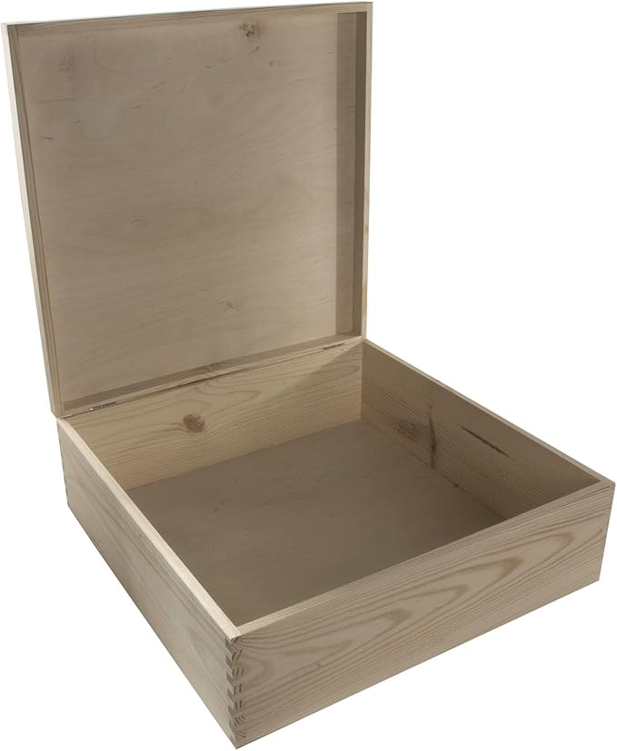 [WooDeeDoo B0973KZMGK](https://www.amazon.co.uk/dp/B0973KZMGK?th=1), **40 × 40 × 13.5 cm** | £33.99 | **£33.99** | Outside **400 × 400 × 135 mm**; inside **approximately 380 × 380 × 125 mm**; 3 mm birch-ply lid/base | Listing text. Original hinges included. The inner size is approximate; check the delivered box and hinge intrusion. |
| P02 · 1 pack of 3 |  [sourcing map chrome steel balls, 27 mm](https://www.amazon.co.uk/dp/B0CCJXJJWR) | £11.19 | **£11.19** | **Ø27 mm**, three balls | Listing size. 30 mm clear lane gives 3 mm total lateral clearance. Not a claim of regulation pinball weight or diameter. |
| P03 · 2 sheets | 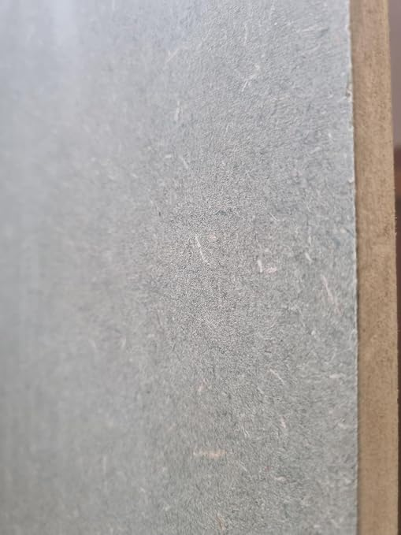 [GATE8 moisture-resistant MDF, B0B21V5VRM](https://www.amazon.co.uk/dp/B0B21V5VRM), **600 × 600 mm, 6 mm thick** | £17.00 | **£34.00** | **600 × 600 × 6 mm** each; one sheet per buy unit | Cut into the carrier, course floor, console top, gate and covers. Keep offcuts for support layers and shims. Listing size/price checked 18 November 2026; in stock. Full-thickness carrier and revised underside fixings required; see mounting notes. |
| P04 · 1 sheet |  [GATE8 moisture-resistant MDF, B0B25KRGVS](https://www.amazon.co.uk/dp/B0B25KRGVS), **600 × 600 mm, 12 mm thick** | £23.00 | **£23.00** | **600 × 600 × 12 mm**; one sheet | Cut into the upright ball-guide walls (30 mm high), console support walls (83 mm high), end stops, support blocks and backing. Listing size/price checked 18 November 2026; in stock. Glue fixed joints; small screw-block and cover fixings need revision. Same generic seller photograph as P03; use the linked thickness. |
| P05 · 8 pairs | 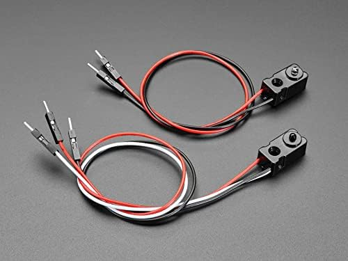 [Adafruit ADA2167 3 mm break-beam sensors](https://www.amazon.co.uk/dp/B01BU6YBWU) | £11.16 | **£89.28** | Each head **20 × 10 × 8 mm**; cable **230 mm**; 3.3–5.5 V | Amazon product identity; dimensions and open-collector output from [Adafruit](https://www.adafruit.com/product/2167). Sixteen heads total. First prove one pair with touching balls, then populate the remaining stations. |
| P06 · 3 packs of 4; use 10 | 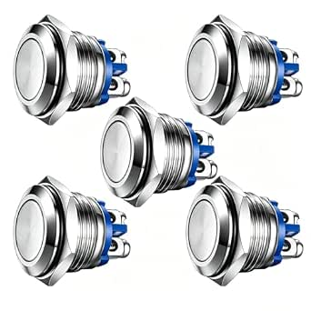 [**Gebildet 12mm Momentary Blue LED High Head**](https://www.amazon.co.uk/dp/B088CNW12P?th=1), B088CNW12P | £7.89 | **£23.67** | Face **Ø14 mm**, hole **Ø12 mm**, actuator **Ø7.4 mm**; maximum panel **8 mm**; separate **12–24 V DC blue LED** and normally-open momentary contact. | Supplied nuts; solder terminals. Overall depth/cap height unpublished: verify the 35 mm rear / 10 mm top allowances. Gallery/text disagree on thread pitch (0.75/0.8 mm); use supplied nuts in plain holes. [Terminal drawing](../../../assets/docs/media/test-bench-parts/p06-dimensions.jpg). |
| P07 · 1 pack of 2 | 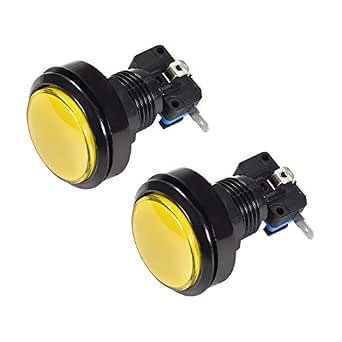 [uxcell yellow 12 V LED arcade buttons](https://www.amazon.co.uk/dp/B07XYWYJFJ) | £13.79 | **£13.79** | Face **Ø46 mm**; listed mounting hole **Ø23.5 mm**; **12 V LED** | Use LED terminals only; switches unused. Nuts supplied. Body depth, cap height and grip unpublished; 65 mm body + 12 mm wire is an allowance. |
| P08 · 1 pack of 2; use 1 | 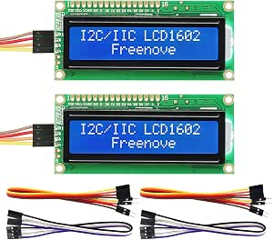 [Freenove I²C LCD1602, new type](https://www.amazon.co.uk/dp/B0B76Z83Y4), **I2C 1602 2 Pack** | £10.95 | **£10.95** | PCB **80 × 36 mm**, mounting holes **Ø3 mm** | Gallery PCB dimensions. Bezel, hole centres and complete thickness unpublished. Reserve 100 × 50, 30 below / 5 above panel; trace the received bezel. |
| P09 · 1 roll of 5 m; reuse if owned | 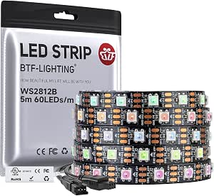 [BTF-LIGHTING WS2812B](https://www.amazon.co.uk/dp/B01CDTEJBG), **5 m / 300 LEDs, Gold Wire Black PCB IP30** | £34.99 | **£34.99** | **5000 × 10 × 2.13 mm**, **5 V**, 60 pixels/m; nominal **16.67 mm cut pitch** | Adhesive-backed; factory joins every 500 mm. Nominal 89 perimeter + 6 status + 6 key pixels. Dry-fit corner bends and cut count; no DIY corner joins. |

### Controllers, interfaces and power

| ID / quantity | Exact product and variant | Price / buy unit | Line total | Published dimensions / specification | Installation and evidence |
| --- | --- | ---: | ---: | --- | --- |
| P10 · 1 if needed | 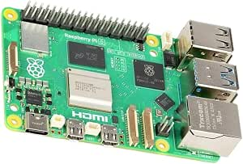 [Raspberry Pi 5, SC1111, 4 GB](https://www.amazon.co.uk/dp/B0CK3L9WD3) | £124.70 (lowest new offer) | **£124.70** | PCB **85 × 56 mm**; holes **Ø2.7 mm**, **58 × 49 mm** centres | Amazon identity; [official mechanical drawing](https://datasheets.raspberrypi.com/rpi5/raspberry-pi-5-mechanical-drawing.pdf). Reserve 110 × 70 mm including USB connection space. Existing Pi 5 can be reused. |
| P11 · 1 | 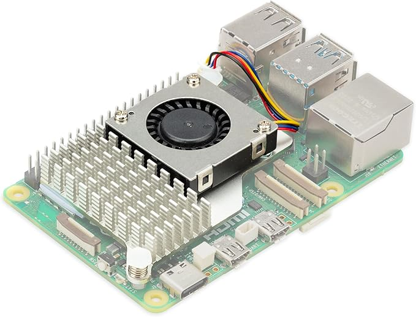 [Official Raspberry Pi Active Cooler, SC1148](https://www.amazon.co.uk/dp/B0CLXZBR5P) | £8.29 | **£8.29** | **63.5 × 42.5 × 13.7 mm** | [Official drawing](https://pip-assets.raspberrypi.com/categories/993-raspberry-pi-active-cooler/documents/RP-008187-DS-1-raspberry-pi-active-cooler-mechanical-drawing.pdf?disposition=inline) and Amazon model. Supplied push pins, thermal pads and fan lead; connect to Pi fan socket. No additional Pi enclosure. |
| P12 · 1 if needed |  [SanDisk High Endurance 32 GB microSDHC](https://www.amazon.co.uk/dp/B07P14QHB7) | £22.55 | **£22.55** | **32 GB**, microSD form factor; standard card envelope **15 × 11 × 1 mm** | Capacity verified in listing; card envelope is the microSD format, not a measured sample. Existing configured card can be reused. Keep access to the Pi card edge. |
| P13 · 1 pack of 2; use 1 | 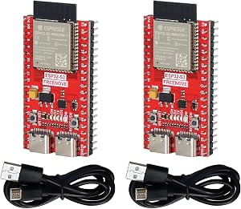 [Freenove ESP32-S3, 16 MB Flash, 2 Pack](https://www.amazon.co.uk/dp/B0FRRJCDHF), **FNK0099K** | £21.95 | **£21.95** | 16 MB flash / 8 MB PSRAM, USB-C; complete board dimensions not published | Concrete new-purchase option. Do not assume it is the same revision as an existing FNK0085. Check firmware target and board pinout before deployment; this design does not assign GPIO numbers. |
| P14 · 1 | 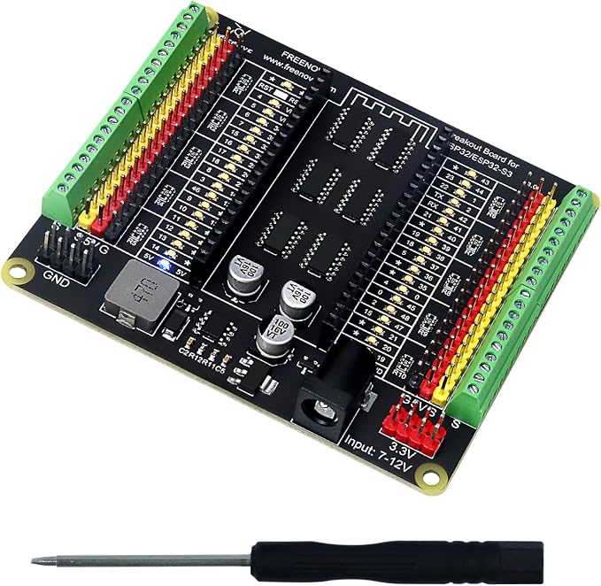 [Freenove FNK0091 breakout](https://www.amazon.co.uk/dp/B0CD2512JV) | £11.95 | **£11.95** | PCB **87 × 75 mm**; 2.54 mm headers | Gallery PCB size (not packaging). Manufacturer lists Freenove ESP32/S3 compatibility. Populated height unpublished; 97 × 105 bay, z≤50 allowance. No separate barrel power. |
| P15 · 1 | 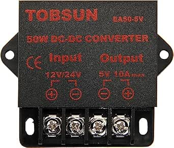 [VOLRANTISE converter](https://www.amazon.co.uk/dp/B09WZ9DC9W), **12/24 V to 5 V 10 A** | £11.99 | **£11.99** | **53 × 50 × 20 mm**; 10–35 V input; 5 V / 10 A advertised output | Amazon dimension drawing. Reserve 90 × 53 mm with connections facing sideways. Supplies lighting/display, not Pi USB-C. Verify output voltage and temperature under the actual load. |
| P16 · 1 pack of 4; use 2 | 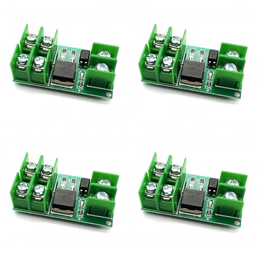 [JZK F5305S optocoupled MOSFET modules](https://www.amazon.co.uk/dp/B09SWRF88D) | £7.09 | **£7.09** | Each **47 × 25 × 15 mm**; input 3–24 V, about 5 mA; load supply 5–36 V | Listing text. Two boards side by side in a 55 × 65 mm bay including bends. Read the board terminal labels; do not infer a generic low-side wiring topology. |
| P17 · 1 | 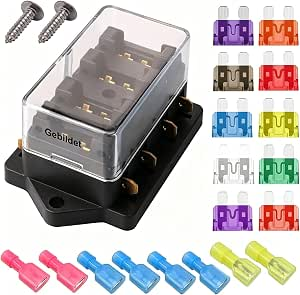 [Gebildet four-way covered blade-fuse box](https://www.amazon.co.uk/dp/B076P4LBSG), **4 way** | £8.44 | **£8.44** | **87 × 52 × 42 mm**; **6.3 mm tabs** | Gallery dimensions; four isolated circuits required, verify by continuity. Cover/eight spades/mixed fuses included. Revised circuit allocation and extra holder positions pending. |
| P18 · 1 kit | 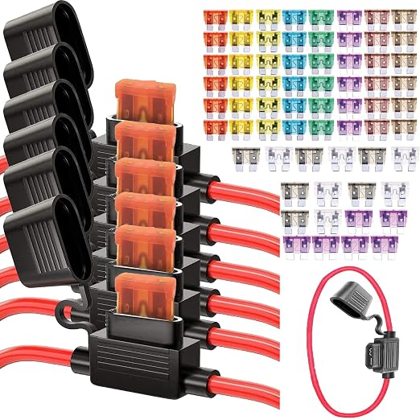 [iLulala six holders / 66 standard blade fuses](https://www.amazon.co.uk/dp/B0DKX9R1FK) | £7.99 | **£7.99** | Six each of **2, 3, 5, 7.5, 10, 15, 20, 25, 30, 35, 40 A** | Six inline holders plus 66 fuses; standard ATO/ATC format. Final fuse schedule and additional holder positions pending for the single inlet. Confirm seating in P17. |
| P19 · 1 | 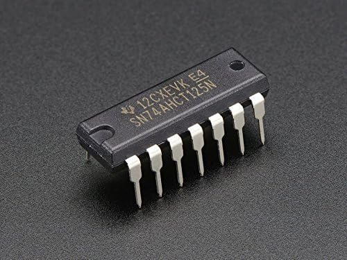 [Adafruit ADA1787 / 74AHCT125](https://www.amazon.co.uk/dp/B00XW2L39K) | £3.46 (+ £6.32 delivery shown) | **£3.46** | **14-pin through-hole DIP**, 2.54 mm pitch | **LED data:** raises ESP 3.3 V data to 5 V; actively driven, one-way buffer. Bare IC soldered to P21, not a ready-made module. [TI datasheet](https://www.ti.com/lit/ds/symlink/sn74ahct125.pdf). |
| P20 · 1 pack of 15; use 1 | 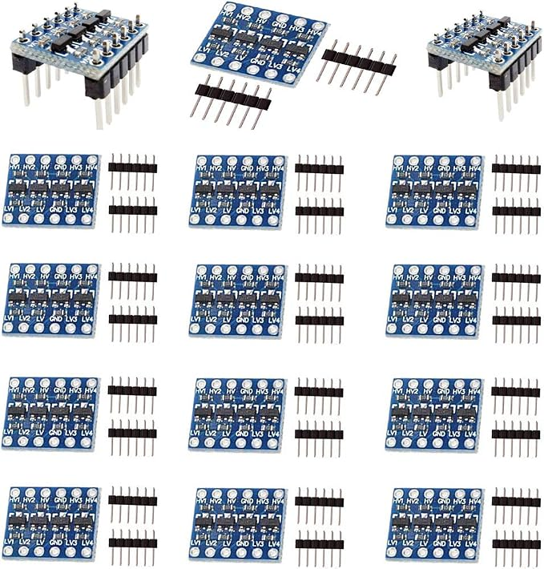 [RUNCCI-YUN four-channel I²C level converters](https://www.amazon.co.uk/dp/B082F6BSB5) | £6.99 | **£6.99** | PCB **13 × 15 mm**, 2.54 mm header pitch | **LCD data:** bidirectional SDA/SCL conversion between 3.3 V and 5 V. Solder to P21; not the selected WS2812 buffer substitute. |
| P21 · 1 kit | 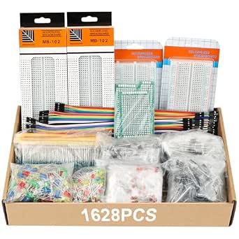 [OFNMY 1628-piece electronics kit](https://www.amazon.co.uk/dp/B0FFTDD9JQ), **1628 PCS** | £22.99 | **£22.99** | PCBs **20 × 80, 30 × 70, 40 × 60, 50 × 70 mm** | Gallery contents include 330 Ω, 4.7 kΩ and 10 kΩ resistors (20 each), 100 nF ceramics, and 470 µF / 16 V electrolytics. Use the 50 × 70 mm board for interfaces; the other boards are spares; detailed component use below. Breadboards are for the preliminary test only. |
| P22 · 1 pack of 25 | 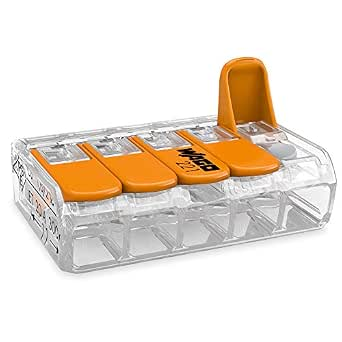 [WAGO 221-415, five-lever connectors](https://www.amazon.co.uk/dp/B0107SYYGU), **5-Lever** | £11.00 | **£11.00** | **29.9 × 18.6 × 8.3 mm**; 0.14–4 mm² flexible copper | [Manufacturer dimensions](https://www.wago.com/global/installation-terminal-blocks-and-connectors/splicing-connector-with-levers/p/221-415). Allow up to six connectors for power distribution, retained by cable ties with levers accessible. Each connector joins all five ports; it is not five isolated poles. |
| P23 · 1 pack of 2; use 1 | 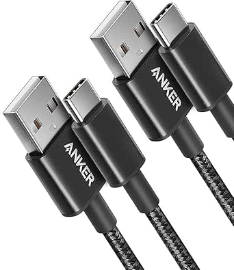 [Anker USB-A to USB-C cable](https://www.amazon.co.uk/dp/B0D5XY3C2T), **0.3 m + 0.3 m, Black** | £5.49 | **£5.49** | **300 mm including connectors**, USB 2 data up to 480 Mbit/s | Listing explicitly confirms data support. Pi USB-A to the ESP programming/serial USB-C port. Connector moulding dimensions not published; use the reserved connection spaces. |
| P24 · 1 | 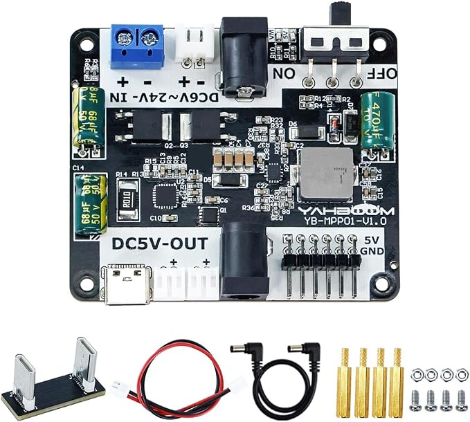 [Yahboom Pi 5 PD power board, B0D3L6Y92G](https://www.amazon.co.uk/dp/B0D3L6Y92G) | £13.99 | **£13.99** | PCB **65 × 56 mm**; **7–24 V input → 5 V / 5 A** with Pi 5 USB-PD negotiation | Selected Pi converter; supplied stacking hardware/dual-USB-C bridge. [Technical specification](https://wiki.geekworm.com/YB-MPP01). Stack height, cooler clearance and terminal access unallocated. Offer adds £14.99 delivery; £28.98 delivered, estimated 14 December 2026 at check. No extra buck in series. |

### Fixings, wire and consumables

| ID / quantity | Exact Amazon.co.uk product | Price / buy unit | Line total | Size / contents | Use |
| --- | --- | ---: | ---: | --- | --- |
| F01 · 1 kit | 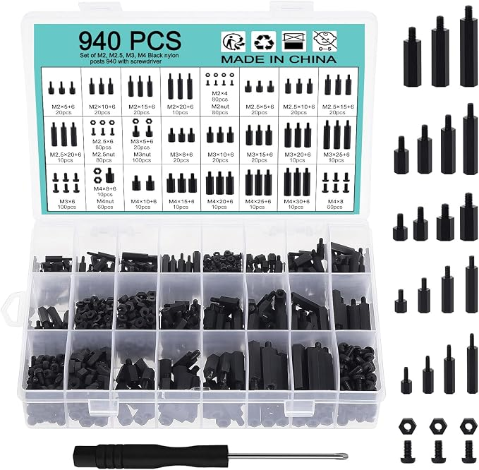 [WiMas 940-piece nylon standoffs](https://www.amazon.co.uk/dp/B0CJFG1XDR), Black | £14.99 | **£14.99** | M2/M2.5/M3/M4; gallery includes **10 mm body + 6 mm male stud**, M2.5×6 and M3×6 screws/nuts | Pi uses M2.5; match other board holes. Carrier retention must be revised for full-thickness MDF; the former recessed-nut arrangement is retired. |
| F02 · 1 kit | 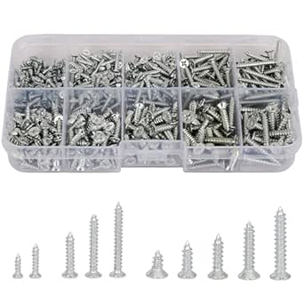 [AMLOOPH 535-piece wood screws](https://www.amazon.co.uk/dp/B0CPF54WYQ) | £6.99 | **£6.99** | M2×6/10; M2.5×12/16/20; M3×8/10/12/16/20 mm | Pilot-drilled wooden joints, clips, console screws and backing. Choose length by the actual material stack; do not blindly use fitting-kit screws. |
| F03 · 1 kit | 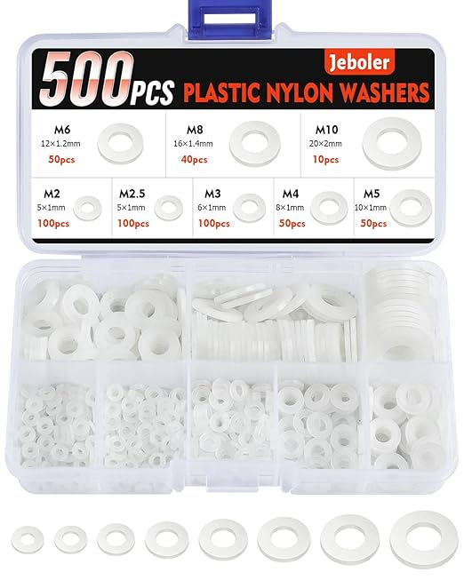 [Jeboler 500 nylon washers](https://www.amazon.co.uk/dp/B0D4952M2T) | £2.68 | **£2.68** | M2, M2.5, M3, M4, M5, M6, M8, M10 | Protect PCB/plastic flanges and spread small-screw loads. Exact washer thickness is not listed; allow and measure it in the fastening stack. |
| F04 · 1 pack if needed |  [Gorilla Wood Glue, 236 ml × 2](https://www.amazon.co.uk/dp/B07BVN1H3B) | £14.25 | **£14.25** | Two **236 ml** bottles | Frame, rails, cleats, pads and lid backing; clamp and cure per bottle instructions. Do not glue the removable console. |
| F05 · 1 kit | 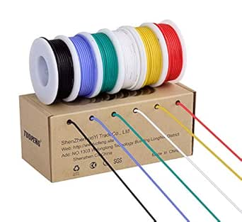 [TUOFENG 18 AWG silicone wire](https://www.amazon.co.uk/dp/B07G744V5Z), 18awg silicone wire set | £15.99 | **£15.99** | Six colours × **13.2 ft / about 4 m**; **2.3 mm OD**; 150×0.08 mm tinned-copper strands | 5 V lighting distribution and return. Recheck the new combined 12 V main-feed gauge against length, current, connector and fuse ratings; this row does not approve 18 AWG for that feed. |
| F06 · 1 kit | 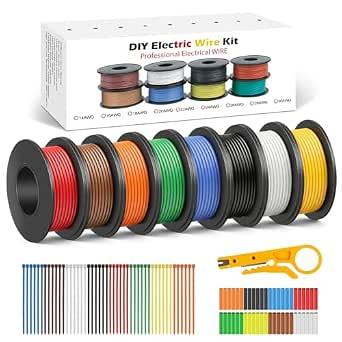 [LEDLightsWorld 22 AWG silicone wire](https://www.amazon.co.uk/dp/B0GXYYP42B), **22 AWG / 0.3 mm²** | £16.90 | **£16.90** | Eight colours × **5 m**, 60×0.08 mm strands; seller rates 3 A | Signals, buttons, sensor extensions, LCD and low-current lamp branches. Includes extra ties/shrink; these are not relied on for the quantities below. |
| F07 · 1 pack of 20 | 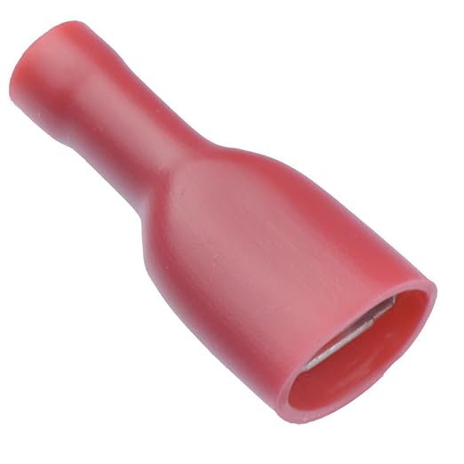 [Switch Electronics fully insulated female spades](https://www.amazon.co.uk/dp/B00XWE7S2Y) | £4.19 | **£4.19** | **6.3 × 0.8 mm**, red, **16–22 AWG** | Eight fuse-box connections, plus spares. Use these correctly sized crimps rather than assuming the included fuse-box spades fit 18 AWG. Lamp LED connections are soldered and insulated. |
| F08 · 1 kit | 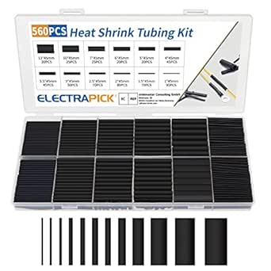 [ELECTRAPICK 560 heat-shrink pieces](https://www.amazon.co.uk/dp/B092VWZN4W), **560PCS** | £6.50 | **£6.50** | **2:1**, **45 mm** lengths; ID 1, 1.5, 2, 2.5, 3, 3.5, 4, 5, 6, 7, 10, 13 mm | Insulate soldered joints and lamp terminals; choose size from the completed joint diameter. |
| F09 · 1 pack of 100 | 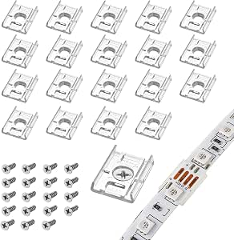 [VIPMOON LED strip clips](https://www.amazon.co.uk/dp/B0B6QQLY6Q), **Type 2 – 10 mm** | £7.99 | **£7.99** | For **10 mm strip**, 100 clips and screws | Supplementary retention at feed points/console rows, between pixels; perimeter primarily uses supplied adhesive. Clip body size unpublished; check pressure and use F02 short screws where needed. |
| F10 · 1 kit | 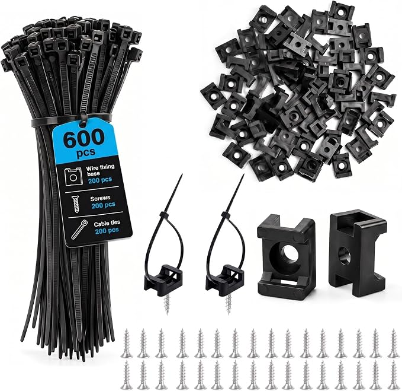 [DYMHQ screw-mount cable-tie set](https://www.amazon.co.uk/dp/B0F5GYZQ97) | £7.99 | **£7.99** | 200 saddles **15 × 10 × 7 mm**, 200 ties **100 mm**, 200 screws | Restrain harnesses and WAGO bodies. Use mechanically retained saddles on suitably sized MDF pads or through-fixings; verify engagement/edge distances. Do not screw into the original 3 mm base. |
| F11 · 1 roll | 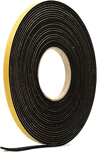 [RS neoprene adhesive strip](https://www.amazon.co.uk/dp/B0086KQSMK), **10 mm wide / 3 mm thick** | £8.40 | **£8.40** | **10 mm × 3 mm × 10 m** | Padded transport cover, cable clamps and base pads. Not a structural adhesive or a substitute for inlet strain relief. |
| F12 · 1 pack of 2 | 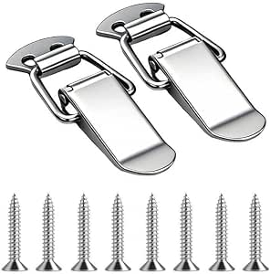 [YOOZIYA A2/304 toggle catches](https://www.amazon.co.uk/dp/B0GLZ2Y67C), **56 mm** | £4.49 | **£4.49** | **56 mm nominal length**, two catches/eight screws | Two on the front. Width, projection and hole pattern not dimensioned. Fit to the actual lid seam, with MDF backing/load-spreading fixings where needed; check closure before drilling. |
| F13 · 1 pack of 2; use 1 | 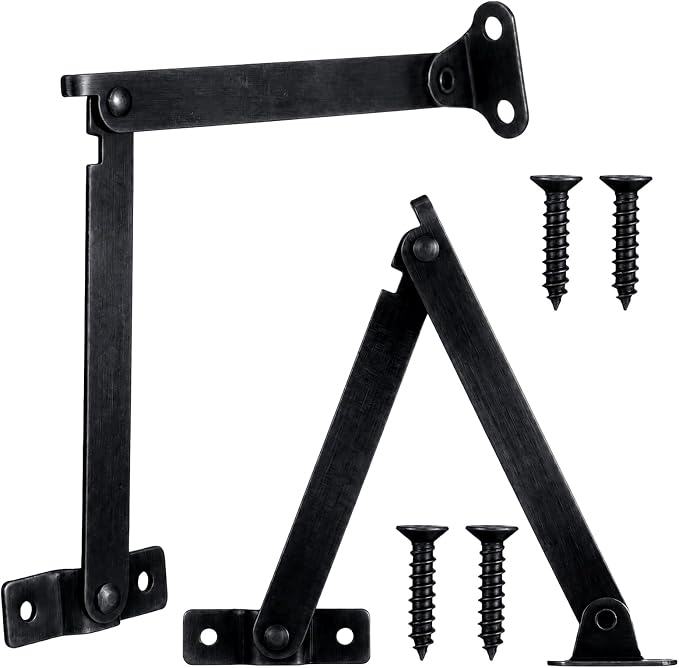 [FdcZeyxior locking lid stays](https://www.amazon.co.uk/dp/B0HCCBXGN8) | £3.99 | **£3.99** | **110 mm folded**, **40 mm foot width**; text says **190 mm** open, drawing **195 mm** | Outside right-rear; set pivots from received part and prove locking/closure. Open-length discrepancy unresolved. Back thin lid material; not a carry handle. |
| F14 · 1 reel if needed | 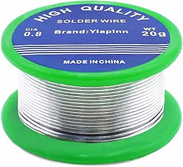 [0.8 mm lead-free rosin-core solder](https://www.amazon.co.uk/dp/B0BFW8TS6H), **0.8mm-15g(Net)** selected option (title says 20 g) | £3.79 | **£3.79** | **Ø0.8 mm**, Sn99.3/Cu0.7; budget one reel at the smaller **15 g net** option | Interface, LEDs and lamp joints. Budget the selected 15 g option despite the 20 g title. Listing melting-temperature text is inconsistent; follow the actual alloy/process. |

### Components taken from the electronics kit

| Function | Fitted parts |
| --- | --- |
| WS2812 data | P19 AHCT125, one **330 Ω** series resistor close to the first pixel, one **10 kΩ** data-input pull-down, one **100 nF** ceramic directly across IC supply pins. Define unused inputs and enables; leave unused outputs disconnected. |
| Optical inputs | Eight **10 kΩ** pull-ups to **3.3 V**, one per receiver output. Receiver/emitter power is 5 V from the protected logic branch; only the open-collector signal reaches ESP inputs. |
| Manual buttons | Ten **4.7 kΩ** pull-ups to **3.3 V**; each button's two switch pins connect its input to common ground. Its separate LED +/− pins connect only to the protected 12 V ring-light bus/return, never to an ESP input. Confirm terminal identity against the product diagram and continuity-test before power. |
| Lamp driver inputs | Two **10 kΩ** pull-downs at the input connectors, subject to confirming active-high behaviour of P16. Verify the lamps remain OFF through reset, USB connection and loss of control. |
| LED supply reservoir | Two **470 µF / 16 V** capacitors in parallel, **940 µF nominal**, across the 5 V lighting input with correct polarity. |
| Soldered boards | **50 × 70 mm** interface board under the console, including low-current common-return connections. Header links from the kit are signal-only, strain-relieved, and must not carry the main strip current. |

The blue rings are fixed-colour 12 V backlights here and add no GPIOs. Solder four insulated leads per button: two for the contact, two for the LED. The metal body is not a return terminal. Keep the 12 V rings separate from the 3.3 V switch inputs.

The schedule uses 11 of the supplied 10 kΩ resistors, ten 4.7 kΩ resistors and one 330 Ω resistor. It requires soldering a small interface circuit; it is not a fully plug-together kit. Route the LED power bus in 18 AWG wire and WAGO connectors, not through thin perfboard traces or the ESP breakout.

## Selected sheet material

**P03 and P04 now select moisture-resistant MDF, replacing both plywood purchases.** P03 is two **600 × 600 × 6 mm** GATE8 sheets at **£17 each**; P04 is one **600 × 600 × 12 mm** GATE8 sheet at **£23**. The £57 sheet total is included below, saving £20.98 against the former plywood. The bought WooDeeDoo box retains its original pine walls and birch-ply lid/base.

The main panel, rail and frame dimensions stay the same. **Small fixing details still need revision:** do not copy the former recessed carrier nuts, tiny screw-in LCD tabs or screws into the narrow rail edges directly into MDF. The [European Panel Federation guidance](https://mdf-info.eu/using-mdf/fixing/screwing) calls for suitable pilot holes and edge distances; several existing small blocks do not provide those distances. Plan larger glued mounting pads or through-bolts with load-spreading washers, then check the added space and select any extra hardware before drilling. These details are not yet dimensioned in the drawings.

MDF provides the preferred smooth finish. Sealer/primer and paint remain unselected and excluded from the subtotal; allow for coating thickness in the gate and ball lane. Moisture-resistant MDF is not waterproof. The earlier realistic illustrations retain their plywood appearance; they do not specify the selected sheet material.

See the [maintained Test Bench page](../../../docs/developer-notes/test-bench.md) for power candidates, mounting and unresolved fit checks.
